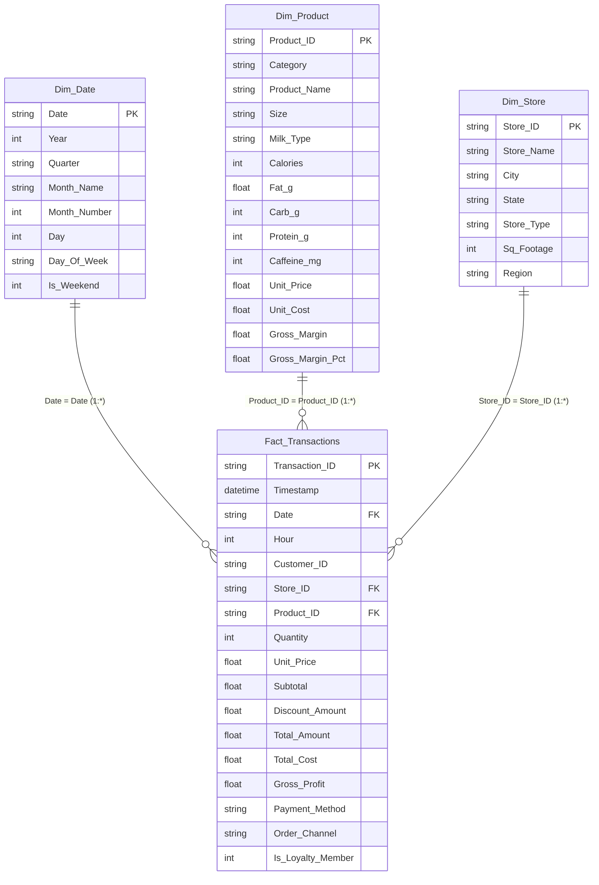

# Starbucks Sales & Product Analytics - Star Schema Data Model

## Architecture Overview
The Power BI semantic model is structured as a pure **Star Schema** to optimize query performance via the VertiPaq engine, avoid bi-directional relationship ambiguity, and ensure seamless DAX filter context propagation.

---

## Relationship Configuration Matrix

| From Table (Dimension) | Primary Key | To Table (Fact) | Foreign Key | Cardinality | Cross Filter Direction | Active |
| :--- | :--- | :--- | :--- | :---: | :---: | :---: |
| `Dim_Product` | `Product_ID` | `Fact_Transactions` | `Product_ID` | `1 : Many (*)` | Single (Dim -> Fact) | Yes |
| `Dim_Store` | `Store_ID` | `Fact_Transactions` | `Store_ID` | `1 : Many (*)` | Single (Dim -> Fact) | Yes |
| `Dim_Date` | `Date` | `Fact_Transactions` | `Date` | `1 : Many (*)` | Single (Dim -> Fact) | Yes |

---

## VertiPaq Storage Engine Optimization Highlights
1. **Explicit Star Schema**: Eliminated snowflake normalization to avoid snowflake join penalties.
2. **Surrogate Keys**: Integer-like and compact alphanumeric IDs (`PRD_001`, `STR_001`) reduce column cardinality and memory footprint.
3. **Column Splitting**: Split high-cardinality `Timestamp` into `Date` (FK to `Dim_Date`) and `Hour` integer (0 to 23), reducing dictionary size from 15,000 distinct strings to 731 dates + 24 hours.
4. **Calculated Measures vs Columns**: All dynamic KPIs (AOV, Gross Margin %, YoY Growth) are built as explicit DAX measures rather than calculated columns to minimize disk and RAM footprint.
